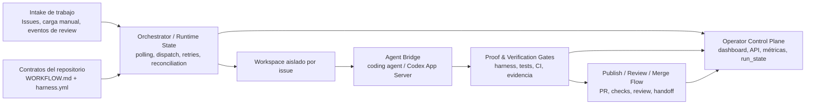
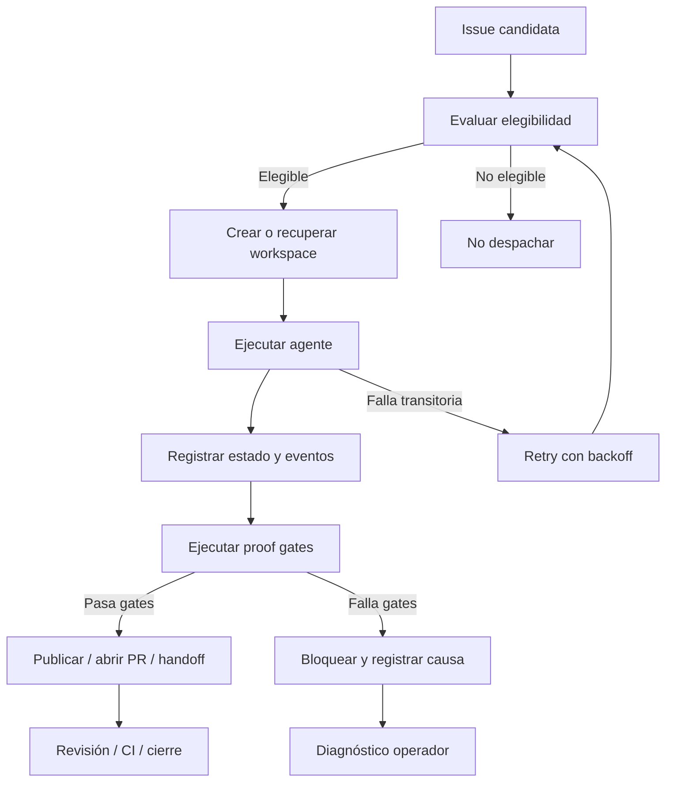
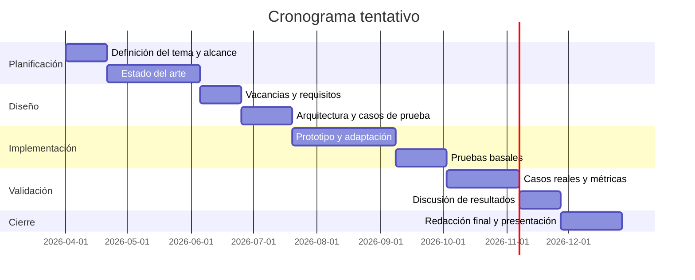

# Plan preliminar de tesis

## Arquitectura de runtime con *proof gates* para delivery autónomo de software basado en *issues*

- **Carrera:** Ingeniería en Informática
- **Asignatura:** Tesis de Grado – Proyecto Final Integrador
- **Tipo de tesis:** Investigación aplicada y desarrollo específico
- **Autor:** [Completar]
- **Director:** [Completar]
**Fecha:** [Completar]

---

## 1. Resumen

El presente plan de tesis propone el diseño, implementación y validación de una arquitectura de runtime para delivery autónomo de software basado en *issues* —tareas o tickets de trabajo gestionados en un sistema de seguimiento—. El problema abordado surge de la brecha existente entre la capacidad actual de los agentes de inteligencia artificial (IA) para generar cambios de código y la necesidad de ejecutar esos cambios dentro de un proceso de ingeniería de software controlable, auditable, recuperable y validado por evidencia.

La propuesta toma como base experimental el proyecto Symphony, en particular el repositorio `gaspardip/symphony`, y lo estudia como un marco integrador para orquestar agentes de software. El foco no está en desarrollar un nuevo agente de programación, sino en formalizar y validar una capa de control que convierta trabajo proveniente de *issues* en corridas aisladas por tarea, con políticas versionadas en el repositorio, *proof gates* —puntos de control basados en evidencia—, observabilidad operativa y recuperación ante fallas.

La validación se realizará mediante pruebas basales del software, escenarios reales reproducibles y métricas asociadas a trazabilidad, recuperabilidad, bloqueo correcto por gates, completitud de evidencia y diagnóstico operacional. El resultado esperado es un prototipo funcional, una arquitectura documentada, una matriz de trazabilidad entre vacancias, requisitos y pruebas, y una evaluación técnica del enfoque propuesto.

---

## 2. Palabras clave

Agentes de software; ingeniería de software; delivery autónomo; integración continua; observabilidad; *proof gates*; *policy-as-code*; runtime; GitHub; Symphony.

---

## 3. Abstract

Pendiente de traducción final al inglés para la versión formal. En esta versión de trabajo se mantiene el cuerpo del documento en castellano para facilitar la revisión académica y evitar ambigüedades en la formulación del problema, el alcance y la validación.

---

## 4. Keywords

Pendiente de traducción final al inglés para la versión formal.

---

## 5. Introducción y situación del tema seleccionado

El tema seleccionado se ubica en la intersección entre ingeniería de software, automatización del delivery, agentes de software, observabilidad operativa y validación de cambios sobre repositorios. En este documento, el término delivery se utiliza para referirse al proceso mediante el cual una tarea de software pasa desde su definición hasta una salida revisable o integrable, por ejemplo un *pull request* (PR), es decir, una solicitud de integración de cambios en un repositorio.

En los últimos años surgieron herramientas capaces de ejecutar tareas de programación en segundo plano a partir de *issues*, comentarios, prompts o tickets. Estas herramientas permiten delegar tareas de desarrollo a agentes de IA que pueden inspeccionar un repositorio, modificar código, ejecutar pruebas y proponer cambios mediante PRs. Sin embargo, el desafío central no es únicamente que el agente pueda generar código, sino que ese trabajo se ejecute dentro de un proceso de software controlable, auditable, recuperable y validado por evidencia.

GitHub Copilot cloud agent permite iniciar tareas de desarrollo desde GitHub Issues, GitHub Copilot Chat y otros puntos de entrada. Según la documentación oficial, el agente trabaja en un entorno impulsado por GitHub Actions, puede investigar el repositorio, crear un plan, modificar código en una rama y opcionalmente abrir un PR [10]. OpenHands, por su parte, ofrece una GitHub Action que puede activarse desde una issue con un label o comentario específico, intentando resolver la tarea y generando un PR para revisión [11]. Estos antecedentes muestran que el patrón “issue → ejecución automatizada → PR” ya existe y, por lo tanto, no constituye por sí mismo una contribución original.

La oportunidad de tesis se encuentra en otro punto: formalizar una capa de control que integre intake de trabajo, ejecución aislada por unidad de trabajo, políticas versionadas en el repositorio, *proof gates*, recuperación ante fallas y observabilidad operacional. En esta propuesta, un *proof gate* se define como un punto de control que exige evidencia verificable antes de permitir que una corrida avance en el flujo. Esa evidencia puede incluir pruebas automatizadas, checks de integración continua, actualización de artefactos de progreso, metadatos de funcionalidad o estado final de corrida.

La propuesta toma como base experimental el proyecto Symphony, particularmente el repositorio `gaspardip/symphony` [1]. Symphony se presenta como un motor de delivery autónomo donde el runtime es dueño del flujo operativo. En el proyecto se documentan componentes como un servicio de orquestación en Elixir/OTP —donde OTP significa *Open Telecom Platform*, conjunto de bibliotecas y patrones de Erlang/Elixir para construir sistemas concurrentes y tolerantes a fallas—, intake desde Linear y carga manual, webhooks de GitHub, workspaces aislados por issue, API JSON —interfaz de programación de aplicaciones que intercambia datos en formato JavaScript Object Notation—, métricas Prometheus y un harness versionado en el repositorio [1], [2], [5], [6].

El objetivo de la tesis no es construir “otro agente que programa”, sino estudiar, formalizar y validar una arquitectura de runtime para delivery autónomo de software basado en *issues*, donde el runtime controle las invariantes operativas: elegibilidad de tareas, aislamiento, límites de ejecución, pruebas, evidencia, observabilidad, recuperación y handoff hacia revisión humana o integración continua.

---

## 6. Definición preliminar de siglas y términos

Las siglas y términos técnicos serán definidos en su primera aparición dentro del documento. Se incluye además esta tabla como referencia de consulta.

| Término o sigla | Definición |
|---|---|
| IA | Inteligencia Artificial. |
| LLM | Modelo de lenguaje de gran escala. Se mantiene la sigla por su uso extendido en la literatura técnica. |
| Issue | Tarea o ticket de trabajo registrado en un sistema de seguimiento. |
| PR | *Pull Request*: solicitud de integración de cambios en un repositorio. |
| CI | Integración continua. Proceso automatizado de construcción, pruebas y validación de cambios. |
| CD | Entrega o despliegue continuo, según el contexto. |
| API | Interfaz de programación de aplicaciones. |
| JSON | Formato de intercambio de datos basado en JavaScript Object Notation. |
| YAML | Formato legible de serialización usado frecuentemente para configuración. |
| OTP | Open Telecom Platform, conjunto de bibliotecas y patrones del ecosistema Erlang/Elixir. |
| HITL | Human in the Loop: intervención humana dentro de un proceso automatizado. |
| Runtime | Capa de ejecución y coordinación responsable de controlar el flujo operativo. |
| Runtime-owned | Enfoque en el cual el runtime controla las invariantes del proceso, en lugar de depender sólo de prompts o supervisión humana informal. |
| Proof gate | Punto de control que exige evidencia verificable antes de avanzar. |
| Policy-as-code | Definición de políticas como artefactos versionados, verificables y ejecutables. |
| Harness | Conjunto de herramientas, contratos, documentación, validadores y procesos que permiten operar agentes de manera más confiable dentro de un repositorio. |
| Handoff | Estado de transferencia hacia revisión humana, PR, integración continua u otra etapa definida por el workflow. |
| ERS | Especificación de Requisitos de Software. |

---

## 7. Estado del arte preliminar

El estado del arte se organiza en categorías que permiten conectar los antecedentes técnicos con las vacancias que fundamentan el problema. No se busca presentar una lista desordenada de herramientas, sino identificar qué capacidades ya existen, cuáles están parcialmente cubiertas y qué integración falta para el tipo de sistema propuesto.

### 7.1. Agentes de software basados en issues

GitHub Copilot cloud agent representa un antecedente directo porque permite iniciar trabajo autónomo desde issues y otros puntos de entrada de GitHub. La documentación oficial indica que el agente puede trabajar en segundo plano, investigar el repositorio, crear un plan, modificar código y opcionalmente abrir un PR [10]. Este enfoque cubre una parte importante del ciclo issue-to-PR, pero se encuentra fuertemente integrado al control plane de GitHub y a su entorno de ejecución basado en GitHub Actions.

OpenHands GitHub Action es otro antecedente relevante. Su documentación indica que la acción puede dispararse desde una issue mediante el label `fix-me` o mediante un comentario que mencione al agente. Luego intenta resolver la issue, genera un PR y permite iterar mediante comentarios o revisiones [11]. Este caso demuestra que el modelo de automatización desde issues también existe en el ecosistema open source.

Estos sistemas prueban que la activación de agentes desde issues no es novedosa. La vacancia aparece cuando se requiere una arquitectura propia, auditable y autoalojable que conecte issue, workspace, runtime, políticas, gates, observabilidad, recuperación y handoff de manera explícita.

### 7.2. Orquestación y ejecución durable

LangGraph es un framework de orquestación de agentes que introduce conceptos relevantes para tareas largas y recuperables. Su documentación define la ejecución durable como la capacidad de guardar progreso en puntos clave para pausar y reanudar workflows, incluso ante interrupciones, errores o intervención humana [12]. También documenta mecanismos de *Human in the Loop* (HITL), donde ciertas acciones se pausan para que una persona apruebe, edite o rechace el paso propuesto [13].

Estos antecedentes resuelven parcialmente el problema de persistencia, pausas e intervención humana. Sin embargo, no proveen por defecto una semántica específica para delivery de software basada en issues, workspaces por tarea, PRs, checks de integración continua, pruebas de repositorio, revisión y handoff. En consecuencia, sirven como referencia conceptual, pero no reemplazan la necesidad de una arquitectura especializada para el problema planteado.

### 7.3. Policy-as-code y validación por gates

Open Policy Agent (OPA) es un motor de políticas de propósito general que permite expresar reglas como código y desacoplar la decisión de política respecto del sistema que la ejecuta [14]. Este enfoque es relevante porque la tesis busca que las reglas del flujo no queden solamente en instrucciones informales, sino que puedan representarse como contratos verificables.

En el ámbito de repositorios, GitHub permite proteger ramas mediante reglas que exigen revisiones aprobatorias o checks exitosos antes de permitir un merge [15]. GitHub Actions, a su vez, permite definir workflows automatizados en archivos YAML versionados en el repositorio, incluyendo procesos de construcción, prueba y despliegue [16]. Estos mecanismos muestran que los gates y la automatización del pipeline ya son prácticas maduras en DevOps.

La diferencia del problema abordado es que, cuando un agente modifica código de manera autónoma, los gates no sólo deben validar el código final, sino también preservar trazabilidad del proceso: qué issue originó la corrida, qué workspace se usó, qué evidencia se produjo, por qué una corrida avanzó o se bloqueó y cómo puede diagnosticarse una falla.

### 7.4. Harness engineering y conocimiento versionado en el repositorio

El enfoque de *harness engineering* publicado por OpenAI propone tratar el conocimiento del repositorio como fuente de verdad estructurada, versionada y verificable. El artículo describe cómo un repositorio puede organizar documentación, planes, especificaciones, reglas de calidad y validaciones para que los agentes operen con mayor legibilidad y menor dependencia de instrucciones extensas o desactualizadas [9].

Symphony se vincula con esta línea mediante artefactos como `WORKFLOW.md`, `.symphony/harness.yml`, documentación de conocimiento en `.symphony/knowledge` y validaciones asociadas al harness [5], [6]. Esta aproximación es relevante porque el control del sistema no se delega únicamente al prompt ni al proveedor del agente, sino que se desplaza hacia contratos versionados dentro del repositorio.

### 7.5. Symphony como antecedente directo

El proyecto upstream `openai/symphony` define Symphony como un servicio de automatización de larga duración que lee trabajo desde un issue tracker, crea un workspace aislado por issue y ejecuta una sesión de agente dentro de ese workspace [7]. La especificación indica que el sistema busca convertir la ejecución de issues en un workflow repetible, aislar agentes por issue, mantener políticas de workflow en el repositorio mediante `WORKFLOW.md` y proveer observabilidad suficiente para operar corridas concurrentes [7].

La implementación Elixir upstream describe un flujo donde Symphony consulta Linear, crea un workspace por issue, lanza Codex en modo App Server dentro del workspace, envía un prompt de workflow y mantiene al agente trabajando hasta que la tarea se complete o llegue a un estado terminal [8].

El fork `gaspardip/symphony` amplía este marco con documentación de arquitectura, producto, harness, observabilidad y planes de autopiloto [1]–[6]. Por eso, en esta tesis Symphony se toma como base experimental y no como contribución terminada. La contribución de la tesis será formalizar el problema, derivar requisitos desde vacancias, adaptar o implementar componentes verificables y validar el modelo mediante casos de prueba reproducibles.

---

## 8. Síntesis del estado del arte y vacancias

A partir del estado del arte se observa que las piezas necesarias para el delivery autónomo de software existen de manera parcial y distribuida: agentes issue-driven, frameworks de orquestación, policy-as-code, CI, branch protection, harness engineering y observabilidad. La vacancia principal no es la inexistencia de estas piezas, sino su falta de integración en un modelo de runtime explícito para delivery autónomo basado en issues.

Antes de presentar la tabla de vacancias, se describen de manera general las principales brechas detectadas:

1. **Ejecución issue-driven parcialmente resuelta:** herramientas como GitHub Copilot cloud agent y OpenHands permiten disparar trabajo desde issues, pero el control del proceso suele quedar acoplado a la plataforma o a una acción puntual.
2. **Aislamiento por tarea no siempre formalizado:** muchos sistemas ejecutan en entornos aislados o runners, pero no siempre convierten el workspace por issue en una invariante explícita, auditable y verificable.
3. **Policy-as-code desacoplado del runtime:** existen motores de política y checks de CI, pero suelen operar como capas separadas del agente y no como parte de una semántica completa de delivery autónomo.
4. **Proof gates limitados a CI:** los checks de CI validan parte del resultado, pero no necesariamente verifican evidencia de proceso, progreso, trazabilidad, metadatos o razón de bloqueo.
5. **Observabilidad insuficiente para corridas agentic:** los logs y métricas generales no siempre permiten reconstruir qué hizo el agente, por qué se bloqueó una corrida o qué evidencia quedó disponible.
6. **Recuperación ante fallas poco clara:** la reanudación de tareas largas existe en frameworks de orquestación, pero no siempre se conecta con tracker, filesystem, workspace, estado de corrida y handoff.
7. **Handoff poco formalizado:** muchos sistemas finalizan en un PR o comentario, pero no modelan estados intermedios como bloqueado, retry, proof-failed, review-ready o merged.

| Vacancia | Estado actual en herramientas existentes | Oportunidad para la tesis |
|---|---|---|
| Ejecución issue-driven | Existe en GitHub Copilot cloud agent y OpenHands. | Formalizar el runtime completo, no sólo la activación por issue. |
| Aislamiento por unidad de trabajo | Algunas herramientas usan runners o entornos propios. | Definir workspaces por issue como invariante verificable. |
| Policy-as-code | Existe en OPA y CI/CD. | Integrar políticas al runtime y al repositorio como contrato operacional. |
| Proof gates | Existen checks de CI y branch protection. | Ampliar la noción de prueba hacia evidencia de corrida, progreso, metadatos y estado. |
| Observabilidad | Existen logs, dashboards y métricas generales. | Definir observabilidad específica para corridas agentic de delivery. |
| Recuperación ante fallas | Existen frameworks de ejecución durable. | Evaluar un modelo de recuperación basado en tracker, filesystem y estado de corrida. |
| Handoff operacional | Usualmente queda reducido a PR o revisión humana. | Modelar estados explícitos de ejecución, bloqueo, revisión y cierre. |

### 8.1. Caso basal representativo

Un caso basal permite visualizar la vacancia general. Una issue elegible ingresa al sistema. El runtime la selecciona, crea un workspace aislado, ejecuta el agente, registra el estado de corrida, aplica los gates definidos por el repositorio y bloquea o publica el resultado según la evidencia disponible. Si falla una prueba de integración continua, la corrida no avanza a handoff final y queda registrada la causa de bloqueo para revisión del operador.

Este caso sintetiza el problema: el valor no está únicamente en generar código, sino en que cada transición del flujo quede controlada, justificada y diagnosticable.

---

## 9. Problema planteado

Los sistemas actuales de desarrollo asistido por agentes pueden generar cambios sobre un repositorio, pero presentan limitaciones para operar dentro de un proceso de software reproducible, auditable y recuperable.

El problema específico es la falta de una arquitectura de runtime que permita:

- recibir trabajo desde issues o mecanismos equivalentes;
- ejecutar una tarea en un workspace aislado;
- aplicar límites explícitos de concurrencia, reintentos y elegibilidad;
- validar avances mediante proof gates;
- registrar evidencia y estado de corrida;
- recuperar o diagnosticar fallas;
- exponer información suficiente para el operador humano;
- diferenciar claramente entre generación de código y validación del proceso.

En ausencia de esta capa de control, la autonomía del agente queda parcialmente gobernada por prompts, scripts ad hoc, intervención humana informal o restricciones del proveedor de plataforma. Esto limita la trazabilidad, dificulta la recuperación ante fallas y reduce la confianza en un proceso de delivery autónomo.

---

## 10. Objetivo general

Diseñar, implementar y validar una arquitectura preliminar de runtime para delivery autónomo de software basado en issues, con límites explícitos, aislamiento por unidad de trabajo, proof gates versionados en repositorio, observabilidad operacional y criterios de validación reproducibles.

---

## 11. Objetivos específicos

1. Analizar el estado del arte de agentes de software issue-driven, runtimes de agentes, orquestadores, policy-as-code, proof gates y observabilidad.
2. Identificar vacancias funcionales y no funcionales vinculadas a control, trazabilidad, recuperación y validación.
3. Derivar requisitos preliminares desde las vacancias detectadas.
4. Diseñar una arquitectura conceptual para un runtime de delivery autónomo basado en issues.
5. Implementar o adaptar un prototipo sobre Symphony para validar la arquitectura.
6. Definir pruebas basales del software y casos de prueba sobre escenarios reales.
7. Medir trazabilidad, recuperabilidad, bloqueo por gates, completitud de evidencia y capacidad de diagnóstico.
8. Documentar limitaciones, riesgos, decisiones de diseño y futuras líneas de trabajo.

---

## 12. Alcance

### 12.1. Incluido

- Modelo de runtime basado en issues.
- Intake desde un tracker o carga manual.
- Workspaces aislados por tarea.
- Estado de corrida y razones de parada.
- Proof gates y validation gates.
- Observabilidad operacional.
- Recuperación básica o diagnóstico tras fallas.
- Casos de prueba reproducibles.
- Matriz de trazabilidad entre vacancias, requisitos, componentes, pruebas y métricas.

### 12.2. Fuera de alcance

- Autonomía total sin revisión humana.
- Soporte completo de múltiples trackers.
- Soporte completo de múltiples proveedores de modelos.
- Garantía formal de corrección semántica del código generado.
- Scheduler distribuido generalista.
- Plataforma multi-tenant de producción.
- Evaluación comparativa de capacidad de modelos LLM como objetivo principal.

La tesis no medirá como objetivo central si el agente produce “mejor código” que otro agente. El foco será evaluar si el runtime mejora control, trazabilidad, recuperabilidad y validación del proceso.

---

## 13. Solución propuesta

La solución preliminar consiste en un marco integrador —framework— de runtime que actúe como capa de control entre el intake de trabajo y la ejecución de agentes de software.

El runtime se organizará en los siguientes módulos conceptuales:

1. **Intake de trabajo:** recepción de tareas desde un tracker, carga manual o eventos de revisión.
2. **Contratos del repositorio:** definición versionada de reglas, políticas, instrucciones de ejecución y límites del flujo.
3. **Orchestrator / runtime state:** componente responsable de polling, scheduling, dispatch, concurrencia, retries, reconciliación y estado autoritativo de corridas.
4. **Workspace aislado por issue:** entorno de ejecución por unidad de trabajo, asociado a una issue o tarea.
5. **Agent bridge:** adaptador hacia el agente de código utilizado para ejecutar la tarea.
6. **Proof and verification gates:** validaciones que deben cumplirse antes de publicar o avanzar.
7. **Publish / review / merge flow:** etapas de publicación, PR, checks, revisión y eventual integración.
8. **Operator control plane:** superficie para visualizar estado, métricas, reportes, logs, razones de bloqueo y evidencia de corrida.

El `SPEC.md` de Symphony define al servicio como una automatización de larga duración que lee trabajo desde un issue tracker, crea un workspace aislado por issue y ejecuta una sesión de agente dentro de ese workspace [2], [7]. También define objetivos concretos: polling con concurrencia acotada, estado autoritativo del orquestador, workspaces determinísticos, stop de corridas cuando cambia la elegibilidad, recuperación ante fallas transitorias, carga del comportamiento desde `WORKFLOW.md`, observabilidad y recuperación tras reinicio sin requerir una base de datos persistente [2], [7].

---

## 14. Diagramas conceptuales

Los diagramas se incluyen en formato Mermaid para facilitar su versionado en GitHub y su posterior exportación a documentos formales.

### 14.1. Arquitectura conceptual preliminar



#### Explicación de componentes

**Intake de trabajo:** representa las fuentes de entrada del sistema. Puede incluir issues de un tracker, carga manual o eventos de revisión. Este componente responde a la necesidad de modelar el trabajo como unidad explícita y trazable.

**Contratos del repositorio:** contiene artefactos versionados como `WORKFLOW.md` y `.symphony/harness.yml`. Estos contratos evitan que el flujo dependa sólo de instrucciones informales, prompts extensos o configuración externa no versionada.

**Orchestrator / Runtime State:** es el núcleo de control. Decide qué tareas son elegibles, cuándo se ejecutan, cuántas corridas simultáneas se permiten, cómo se reintentan fallas y cómo se reconstruye el estado luego de una interrupción.

**Workspace aislado por issue:** representa el entorno de trabajo de una tarea específica. Permite separar cambios, logs y estado por unidad de trabajo, reduciendo interferencia entre corridas concurrentes.

**Agent Bridge:** desacopla el runtime del agente concreto. En el prototipo puede utilizar Codex App Server, pero conceptualmente permite separar la lógica del runtime de la lógica del proveedor de agente.

**Proof & Verification Gates:** concentran las validaciones que deben cumplirse antes de avanzar. Incluyen pruebas automatizadas, checks de CI, evidencia de progreso, metadatos y reglas del harness.

**Publish / Review / Merge Flow:** modela el paso hacia PR, revisión, checks, handoff y eventual integración. No implica que el sistema deba mergear automáticamente; el handoff puede ser revisión humana.

**Operator Control Plane:** ofrece visibilidad operacional. Permite consultar estado, métricas, razones de bloqueo, resultados de pruebas y evidencia asociada a cada corrida.

#### Explicación de flujos

La flecha desde **Intake** hacia **Orchestrator** indica que toda tarea debe pasar por elegibilidad y scheduling antes de ejecutarse. La flecha desde **Contratos del repositorio** hacia **Orchestrator** indica que las decisiones del runtime deben basarse en reglas versionadas. La flecha desde **Orchestrator** hacia **Workspace** indica que cada tarea aceptada se ejecuta en un espacio aislado. La salida del **Agent Bridge** se somete a **Proof & Verification Gates**, y sólo si esos gates producen evidencia suficiente se habilita el flujo hacia publicación, revisión o handoff. El **Operator Control Plane** recibe información desde el runtime, los gates y el flujo de publicación para permitir diagnóstico y auditoría.

### 14.2. Ciclo operacional propuesto



Este ciclo resume el comportamiento esperado: ninguna tarea debería avanzar por mera generación de código. Cada avance debe estar mediado por elegibilidad, estado, evidencia y reglas explícitas.

---

## 15. Requisitos preliminares

Los requisitos se derivan de las vacancias identificadas en el estado del arte. Se distinguen requisitos funcionales y no funcionales, tomando como referencia general las prácticas de especificación de requisitos de software. IEEE 830-1998 fue una referencia histórica para especificaciones de requisitos, reemplazada posteriormente por ISO/IEC/IEEE 29148 [18], [19].

### 15.1. Requisitos funcionales

| Código | Requisito funcional |
|---|---|
| RF-01 | El sistema debe aceptar tareas desde issues o carga manual. |
| RF-02 | El sistema debe evaluar elegibilidad antes de despachar una tarea. |
| RF-03 | El sistema debe crear o reutilizar un workspace aislado por issue. |
| RF-04 | El sistema debe mantener estado de corrida por tarea. |
| RF-05 | El sistema debe ejecutar proof gates antes de permitir publicación o handoff. |
| RF-06 | El sistema debe registrar razón de parada, bloqueo o finalización. |
| RF-07 | El sistema debe permitir diagnóstico mediante API, dashboard, logs o artefactos persistidos. |
| RF-08 | El sistema debe manejar fallas transitorias mediante reintentos acotados. |
| RF-09 | El sistema debe exponer métricas mínimas de operación. |
| RF-10 | El sistema debe separar la lógica del runtime de la lógica del agente concreto. |

### 15.2. Requisitos no funcionales

| Código | Requisito no funcional |
|---|---|
| RNF-01 | El flujo debe ser trazable desde issue hasta handoff o bloqueo. |
| RNF-02 | La evidencia mínima de cada corrida debe quedar persistida. |
| RNF-03 | Los límites de concurrencia y retry deben ser explícitos. |
| RNF-04 | Las políticas y contratos deben ser versionables en el repositorio. |
| RNF-05 | El sistema debe permitir recuperación o diagnóstico luego de interrupciones. |
| RNF-06 | El prototipo debe poder ejecutarse en un entorno controlado y reproducible. |
| RNF-07 | El sistema debe minimizar el acceso del agente a credenciales y recursos innecesarios. |
| RNF-08 | La validación debe ser independiente de la calidad absoluta del código generado por el LLM. |

---

## 16. Matriz de trazabilidad

La siguiente matriz conecta vacancias del estado del arte con requisitos, componentes de la solución, casos de prueba y métricas. Esta tabla busca asegurar que el estado del arte no quede como una sección aislada, sino que fundamente directamente el problema, la solución y la validación.

| Vacancia | Requisito derivado | Componente de la solución | Caso de prueba | Métrica |
|---|---|---|---|---|
| Ejecución issue-driven incompleta | RF-01, RF-02 | Intake + Orchestrator | Happy path | Tasa de corridas completadas |
| Aislamiento poco formalizado | RF-03, RNF-06 | Workspace aislado | Creación de workspace | 100% de workspaces por issue válida |
| Policy-as-code desacoplado | RF-05, RNF-04 | Contratos del repositorio + gates | Bloqueo por policy | Tasa de bloqueos correctos |
| Proof gates limitados a CI | RF-05, RF-06 | Proof & Verification Gates | Falla de evidencia | 100% de inválidos bloqueados |
| Observabilidad insuficiente | RF-04, RF-07, RF-09 | Operator Control Plane | Diagnóstico operacional | Completitud de evidencia y tiempo de diagnóstico |
| Recuperación ante fallas poco clara | RF-08, RNF-05 | Orchestrator / Runtime State | Crash y recuperación | Porcentaje de recuperaciones correctas |
| Handoff no formalizado | RF-06, RNF-01 | Publish / Review / Merge Flow | Handoff a revisión | Trazabilidad issue → PR/revisión |
| Dependencia del proveedor de agente | RF-10 | Agent Bridge | Ejecución con stub o bridge alternativo | Separación runtime/agente demostrada |
| Riesgo por permisos o secretos | RNF-07 | Seguridad y hardening | Intento fuera de alcance | Acceso bloqueado o documentado |

---

## 17. Diferenciación entre Symphony existente y aporte de tesis

Para evitar que la tesis sea interpretada como una simple descripción o uso de un fork existente, se explicita la diferencia entre base experimental y contribución académica/técnica.

| Elemento | Existe en Symphony | Se implementa/adapta en la tesis | Se valida en la tesis |
|---|---:|---:|---:|
| Intake desde tracker o carga manual | Sí | Sí | Sí |
| Workspace por issue | Sí | Sí | Sí |
| Estado de corrida | Sí/parcial | Se formaliza | Sí |
| Proof gates / harness | Sí/parcial | Se categoriza y prueba | Sí |
| Observabilidad operativa | Sí/parcial | Se ordena como modelo | Sí |
| Matriz vacancia → requisito → prueba | No | Sí | Sí |
| Criterios de aceptación cuantitativos | No | Sí | Sí |
| Evaluación reproducible del runtime | No | Sí | Sí |
| Comparación sistemática con estado del arte | No | Sí | Sí |
| Análisis de riesgos y permisos | Parcial | Sí | Sí/parcial |

La tesis no pretende atribuir como novedosos los componentes ya presentes en Symphony o en otros sistemas. El aporte se ubica en la formalización del problema, la derivación de requisitos, la arquitectura de integración, la validación mediante pruebas reproducibles y el análisis crítico de vacancias.

---

## 18. Tecnologías previstas

### 18.1. Tecnologías de implementación

| Tecnología | Uso previsto | Justificación |
|---|---|---|
| Elixir/OTP | Servicio de orquestación | Symphony ya posee implementación basada en Elixir/OTP y este ecosistema es adecuado para procesos concurrentes y supervisados [1], [8], [20]. |
| Phoenix / Phoenix LiveView | Dashboard o superficie web | Permite construir interfaces web con estado del lado servidor y actualización en tiempo real [21]. |
| JSON API | Consulta de estado y reportes | Permite exponer estado de runtime de manera estructurada y consumible por dashboard o scripts. |
| Prometheus | Métricas operativas | Prometheus recolecta métricas como series temporales y es adecuado para observabilidad de sistemas [17]. |
| Git / GitHub | Repositorio, ramas y PRs | El flujo de software a validar se apoya en repositorios y PRs. |
| GitHub Actions | Checks de CI | Permite workflows versionados en YAML dentro del repositorio [16]. |
| Linear | Tracker inicial | Es el tracker contemplado por la especificación actual de Symphony [2], [7]. |
| Codex App Server | Agente de código inicial | El App Server provee una API JSON-RPC bidireccional para integrar clientes con Codex [22]. |
| Markdown / YAML | Contratos versionados | Permiten definir documentación, workflow y harness como archivos legibles y versionados. |

### 18.2. Tecnologías de validación

- Tests unitarios sobre componentes del runtime.
- Tests de integración sobre orquestador, workspace y gates.
- Scripts de preflight, validación, smoke test y post-merge.
- CI con checks requeridos.
- Métricas y estado de corrida persistido.
- Fixtures de issues y escenarios reproducibles.

---

## 19. Experimentación, validación y pruebas

La validación se enfocará en el runtime y el proceso, no en la calidad absoluta del código generado por el agente. El alcance de la validación será: control de ejecución, trazabilidad, aislamiento, gates, recuperación, observabilidad y diagnóstico.

### 19.1. Validación conceptual

Se verificará que la arquitectura propuesta responda a las vacancias detectadas en el estado del arte.

Criterios:

- cada componente debe cubrir una vacancia identificada;
- cada vacancia debe derivar en al menos un requisito;
- cada requisito relevante debe tener al menos un caso de prueba;
- las métricas deben evaluar propiedades del runtime y no sólo resultados del agente.

### 19.2. Pruebas basales del software

| Caso | Descripción | Resultado esperado |
|---|---|---|
| PB-01 | Carga de `WORKFLOW.md` válido | El runtime carga configuración e instrucciones. |
| PB-02 | Carga de `WORKFLOW.md` inválido | El runtime expone error de configuración. |
| PB-03 | Creación de workspace | Se crea workspace aislado para una issue elegible. |
| PB-04 | Control de concurrencia | No se despachan más corridas que el máximo configurado. |
| PB-05 | Persistencia de estado | La corrida deja etapa, estado y razón final. |
| PB-06 | Validación de harness | Se detecta ausencia de artefactos requeridos. |
| PB-07 | Exposición de observabilidad | El runtime expone estado, métricas o reportes. |
| PB-08 | Retry controlado | Una falla transitoria genera reintento acotado. |

### 19.3. Casos de prueba sobre escenarios reales

#### Caso 1 — Happy path

Una issue simple es tomada por el runtime, se crea workspace, se ejecuta el agente, se validan los gates y se genera un handoff o PR listo para revisión.

**Resultado esperado:** corrida exitosa con evidencia completa.

#### Caso 2 — Issue no elegible

Una issue cambia de estado mientras está en ejecución o deja de cumplir criterios de elegibilidad.

**Resultado esperado:** el runtime detecta el cambio, detiene o libera la corrida y registra razón de parada.

#### Caso 3 — Falla transitoria y retry

El agente o una dependencia falla temporalmente.

**Resultado esperado:** el runtime aplica retry con backoff y evita duplicar dispatch.

#### Caso 4 — Bloqueo por proof gate

El agente modifica código, pero no actualiza progreso, evidencia o metadatos requeridos.

**Resultado esperado:** el gate bloquea el avance y registra la causa.

#### Caso 5 — Falla de CI

El cambio genera un PR o pre-PR, pero falla un check requerido.

**Resultado esperado:** el sistema no avanza hacia merge y deja evidencia del fallo.

#### Caso 6 — Recuperación tras interrupción

Se interrumpe el proceso del runtime durante una corrida.

**Resultado esperado:** al reiniciar, el sistema reconstruye el estado suficiente desde tracker, filesystem o estado persistido y evita duplicar trabajo.

#### Caso 7 — Diagnóstico operacional

Se entrega al evaluador una corrida fallida y se debe reconstruir qué ocurrió.

**Resultado esperado:** se puede diagnosticar usando dashboard, API, métricas, logs y `run_state`.

### 19.4. Criterios de aceptación cuantitativos

| Métrica | Criterio de aceptación preliminar |
|---|---|
| Duplicación de dispatch | 0 duplicaciones incorrectas en los casos de prueba definidos. |
| Completitud de evidencia | 100% de corridas con estado final, razón de parada y evidencia mínima. |
| Recuperación tras falla | Al menos 80% de escenarios de interrupción recuperados o diagnosticados correctamente. |
| Bloqueo por proof gate | 100% de casos inválidos bloqueados antes de publish/handoff. |
| Diagnóstico operacional | Reconstruir una corrida fallida usando artefactos del sistema sin inspección manual del código fuente. |
| Trazabilidad issue → resultado | 100% de casos reales con vínculo entre issue, workspace, corrida y resultado final. |
| Control de concurrencia | 0 violaciones del límite configurado durante pruebas. |
| Exposición de métricas | Métricas disponibles en 100% de corridas ejecutadas durante la validación. |

---

## 20. Metodología de trabajo

Se utilizará una metodología iterativa e incremental, organizada en ciclos de análisis, diseño, implementación y validación. La validación seguirá un enfoque de investigación aplicada: primero se derivarán requisitos desde las vacancias del estado del arte, luego se implementará o adaptará el prototipo y finalmente se ejecutarán pruebas basales y escenarios reales reproducibles.

### 20.1. Etapas metodológicas

1. **Relevamiento y estado del arte:** análisis de herramientas, frameworks, especificaciones y documentación técnica.
2. **Síntesis de vacancias:** identificación de brechas funcionales y no funcionales.
3. **Derivación de requisitos:** formulación de requisitos funcionales y no funcionales a partir de vacancias.
4. **Diseño de arquitectura:** definición de componentes, flujos y responsabilidades.
5. **Implementación/adaptación del prototipo:** desarrollo incremental sobre Symphony.
6. **Pruebas basales:** validación de componentes individuales.
7. **Casos reales reproducibles:** ejecución de escenarios representativos.
8. **Medición y discusión:** análisis de métricas, límites y resultados.
9. **Documentación final:** consolidación de tesis, anexos, demos y video.

### 20.2. Gestión de alcance

El alcance se controlará mediante la matriz de trazabilidad. Sólo se considerarán obligatorios los componentes vinculados a vacancias principales y casos de prueba definidos. Las extensiones como soporte multi-provider, multi-tracker o hardening avanzado quedarán como trabajo futuro salvo que resulten indispensables para la validación.

### 20.3. Gestión de calidad

La calidad se verificará mediante:

- pruebas automatizadas;
- criterios de aceptación cuantitativos;
- documentación técnica en Markdown;
- revisión periódica con director;
- trazabilidad entre requisito y prueba;
- registro de decisiones de diseño.

---

## 21. Plan de actividades preliminar

| Etapa | Actividades | Entregables |
|---|---|---|
| 1. Definición del tema | Ajuste de título, problema y alcance | Propuesta preliminar |
| 2. Estado del arte | Relevamiento de herramientas, papers y documentación | Tabla comparativa y síntesis de vacancias |
| 3. Requisitos | Derivación de RF/RNF desde vacancias | ERS preliminar y matriz de trazabilidad |
| 4. Diseño | Arquitectura, diagramas, flujos y componentes | Documento de diseño |
| 5. Implementación | Adaptación o desarrollo del prototipo | Código, configuración y documentación técnica |
| 6. Pruebas basales | Tests unitarios e integración | Reporte de pruebas basales |
| 7. Casos reales | Ejecución de escenarios representativos | Reporte de validación |
| 8. Discusión | Análisis de métricas, límites y riesgos | Resultados y discusión |
| 9. Cierre | Redacción final, anexos, video y presentación | Documento final de tesis |

### 21.1. Cronograma tentativo



Las fechas son tentativas y deberán ajustarse al calendario formal de la cátedra.

---

## 22. Disponibilidad de datos, infraestructura, servidumbres y dependencias

### 22.1. Datos

No se requieren datasets masivos. La validación puede realizarse con:

- repositorios de prueba;
- issues diseñadas para escenarios específicos;
- fixtures de tracker;
- corridas controladas;
- evidencia generada por el propio runtime.

### 22.2. Infraestructura

Se requerirá:

- entorno local de desarrollo;
- repositorio Git;
- ejecución de tests;
- integración con GitHub Actions o equivalente;
- runtime Elixir/OTP;
- almacenamiento de workspaces;
- métricas y logs locales;
- eventualmente contenedores para aislar ejecución.

### 22.3. Servidumbres y dependencias

| Dependencia | Riesgo | Alternativa |
|---|---|---|
| Linear | API externa o credenciales | Carga manual o fixtures de issues |
| GitHub | Disponibilidad de PR/CI | Repositorio local con scripts de validación |
| Codex App Server | Proveedor específico | Agente stub o bridge alternativo para pruebas de runtime |
| GitHub Actions | CI externa | Tests locales reproducibles |
| Prometheus | Métricas externas | Exportación básica de métricas o logs estructurados |

---

## 23. Matriz de riesgos

| Riesgo | Impacto | Probabilidad | Mitigación |
|---|---:|---:|---|
| Cambios en APIs externas | Medio | Media | Mantener modo de carga manual y fixtures. |
| Dependencia de proveedor de agente | Alto | Media | Evaluar el runtime con tareas simuladas o agente stub. |
| CI inestable | Medio | Media | Definir checks locales reproducibles. |
| Scope demasiado amplio | Alto | Media | Acotar a un tracker, un repositorio y un proveedor inicial. |
| Resultados variables del agente | Alto | Alta | No medir calidad absoluta del código como objetivo principal. |
| Gráficos poco legibles en exportación | Bajo | Media | Mantener diagramas en Mermaid versionados y exportarlos con herramienta estable. |
| Ambigüedad entre fork y aporte | Alto | Media | Mantener tabla de diferenciación Symphony existente vs aporte tesis. |
| Manejo inseguro de secretos | Alto | Media | Minimizar credenciales, documentar permisos y usar entorno controlado. |
| Falta de datos reales | Medio | Baja | Diseñar escenarios reproducibles con issues de prueba. |

---

## 24. Seguridad, permisos y secretos

Como el sistema ejecuta agentes que pueden modificar repositorios, la tesis debe considerar explícitamente seguridad, permisos y secretos.

### 24.1. Principios de seguridad

- El agente no debe recibir más permisos de los necesarios.
- Las credenciales deben estar separadas del repositorio.
- El acceso a APIs externas debe estar limitado al alcance de prueba.
- El workspace debe estar acotado por tarea.
- Los logs no deben exponer secretos.
- Los casos de prueba deben incluir al menos un escenario de intento fuera de alcance.

### 24.2. Límites del prototipo

El prototipo no buscará resolver seguridad de producción completa. Sin embargo, documentará:

- qué credenciales se requieren;
- qué permisos tiene el agente;
- qué rutas del filesystem puede modificar;
- cómo se limita la ejecución;
- qué riesgos quedan como trabajo futuro.

### 24.3. Línea futura

Como línea futura se propone evaluar hardening mediante contenedores, sandboxing, restricciones de red, credenciales de menor privilegio y políticas explícitas por tipo de tarea.

---

## 25. Resultados esperados

Se espera obtener:

1. Un estado del arte comparativo sobre agentes issue-driven, runtimes, policy-as-code, proof gates y observabilidad.
2. Una síntesis de vacancias funcionales y no funcionales.
3. Una arquitectura conceptual de runtime para delivery autónomo basado en issues.
4. Un prototipo funcional o adaptación verificable sobre Symphony.
5. Una matriz de trazabilidad vacancia → requisito → componente → prueba → métrica.
6. Un conjunto de pruebas basales del software.
7. Un conjunto de casos de prueba sobre escenarios reales reproducibles.
8. Un análisis de resultados, límites y riesgos.
9. Documentación técnica versionada en el repositorio.

---

## 26. Organización propuesta del repositorio de tesis

Se propone mantener la documentación de tesis dentro del fork de Symphony, en una carpeta separada, para facilitar trazabilidad entre investigación, diseño, implementación y validación.

Estructura sugerida:

```text
tesis/
  README.md
  propuesta/
    plan.md
    resumen.md
  estado-del-arte/
    taxonomia.md
    matriz-comparativa.md
    referencias.md
  problema/
    vacancias.md
    requisitos.md
    matriz-trazabilidad.md
  solucion/
    arquitectura.md
    diagramas.md
    tecnologias.md
  validacion/
    pruebas-basales.md
    casos-reales.md
    metricas.md
    resultados.md
  gestion/
    cronograma.md
    riesgos.md
    reuniones.md
  anexos/
    glosario.md
    exportacion.md
```

Esta organización permite versionar cambios, vincular documentación con código, revisar avances desde GitHub y exportar el contenido a PDF o DOCX con herramientas como Pandoc, Quarto o plugins de Mermaid.

---

## 27. Referencias citadas

[1] G. Dip, “gaspardip/symphony,” GitHub repository. Disponible: https://github.com/gaspardip/symphony. Accedido: 2026-05-08.

[2] G. Dip, “SPEC.md,” `gaspardip/symphony`, GitHub. Disponible: https://github.com/gaspardip/symphony/blob/main/SPEC.md. Accedido: 2026-05-08.

[3] G. Dip, “architecture.md,” `gaspardip/symphony`, GitHub. Disponible: https://github.com/gaspardip/symphony/blob/main/.symphony/knowledge/architecture.md. Accedido: 2026-05-08.

[4] G. Dip, “product.md,” `gaspardip/symphony`, GitHub. Disponible: https://github.com/gaspardip/symphony/blob/main/.symphony/knowledge/product.md. Accedido: 2026-05-08.

[5] G. Dip, “AGENT_HARNESS.md,” `gaspardip/symphony`, GitHub. Disponible: https://github.com/gaspardip/symphony/blob/main/docs/AGENT_HARNESS.md. Accedido: 2026-05-08.

[6] G. Dip, “harness.yml,” `gaspardip/symphony`, GitHub. Disponible: https://github.com/gaspardip/symphony/blob/main/.symphony/harness.yml. Accedido: 2026-05-08.

[7] OpenAI, “Symphony Service Specification,” `openai/symphony`, GitHub. Disponible: https://github.com/openai/symphony/blob/main/SPEC.md. Accedido: 2026-05-08.

[8] OpenAI, “Symphony Elixir,” `openai/symphony`, GitHub. Disponible: https://github.com/openai/symphony/blob/main/elixir/README.md. Accedido: 2026-05-08.

[9] R. Lopopolo, “Harness engineering: leveraging Codex in an agent-first world,” OpenAI, 2026. Disponible: https://openai.com/index/harness-engineering/. Accedido: 2026-05-08.

[10] GitHub Docs, “About GitHub Copilot cloud agent.” Disponible: https://docs.github.com/copilot/concepts/about-copilot-coding-agent. Accedido: 2026-05-08.

[11] OpenHands Docs, “OpenHands GitHub Action.” Disponible: https://docs.openhands.dev/openhands/usage/how-to/github-action. Accedido: 2026-05-08.

[12] LangChain Docs, “LangGraph durable execution.” Disponible: https://docs.langchain.com/oss/python/langgraph/durable-execution. Accedido: 2026-05-08.

[13] LangChain Docs, “Human-in-the-loop.” Disponible: https://docs.langchain.com/oss/python/langchain/human-in-the-loop. Accedido: 2026-05-08.

[14] Open Policy Agent, “Open Policy Agent Documentation.” Disponible: https://www.openpolicyagent.org/docs. Accedido: 2026-05-08.

[15] GitHub Docs, “About protected branches.” Disponible: https://docs.github.com/articles/about-protected-branches. Accedido: 2026-05-08.

[16] GitHub Docs, “GitHub Actions documentation.” Disponible: https://docs.github.com/en/actions. Accedido: 2026-05-08.

[17] Prometheus, “Overview.” Disponible: https://prometheus.io/docs/introduction/overview/. Accedido: 2026-05-08.

[18] IEEE Standards Association, “IEEE 830-1998: IEEE Recommended Practice for Software Requirements Specifications.” Disponible: https://standards.ieee.org/standard/830-1998.html. Accedido: 2026-05-08.

[19] ISO, “ISO/IEC/IEEE 29148:2018 Systems and software engineering — Life cycle processes — Requirements engineering.” Disponible: https://www.iso.org/standard/72089.html. Accedido: 2026-05-08.

[20] Elixir, “Elixir Documentation.” Disponible: https://elixir-lang.org/docs.html. Accedido: 2026-05-08.

[21] Phoenix Framework, “Phoenix LiveView,” GitHub repository. Disponible: https://github.com/phoenixframework/phoenix_live_view. Accedido: 2026-05-08.

[22] C. Chen, “Unlocking the Codex harness: how we built the App Server,” OpenAI, 2026. Disponible: https://openai.com/index/unlocking-the-codex-harness/. Accedido: 2026-05-08.

---

## 28. Bibliografía complementaria

- OpenAI, “An open-source spec for Codex orchestration: Symphony,” 2026. Disponible: https://openai.com/index/open-source-codex-orchestration-symphony/.
- GitHub, “Managing cloud agents,” GitHub Docs. Disponible: https://docs.github.com/en/copilot/how-tos/use-copilot-agents/manage-agents.
- GitHub, “Starting GitHub Copilot sessions,” GitHub Docs. Disponible: https://docs.github.com/en/copilot/how-tos/use-copilot-agents/cloud-agent/start-copilot-sessions.
- All Hands AI, “openhands-github-action,” GitHub repository. Disponible: https://github.com/All-Hands-AI/openhands-github-action.
- LangChain, “LangGraph documentation.” Disponible: https://docs.langchain.com/oss/python/langgraph/.
- OpenAI Developers, “OpenAI Developers Documentation.” Disponible: https://developers.openai.com/.

---

## 29. Cierre preliminar

La propuesta se orienta a estudiar y construir una arquitectura de runtime para delivery autónomo de software donde el foco no está en reemplazar al desarrollador ni en demostrar que un agente escribe mejor código, sino en controlar el proceso mediante límites explícitos, aislamiento, proof gates, políticas versionadas y observabilidad.

El aporte esperado es una solución acotada, verificable y alineada con una tesina de grado: un prototipo funcional, una formalización de arquitectura, una matriz de trazabilidad, criterios de aceptación cuantitativos y una evaluación sobre escenarios reproducibles.
